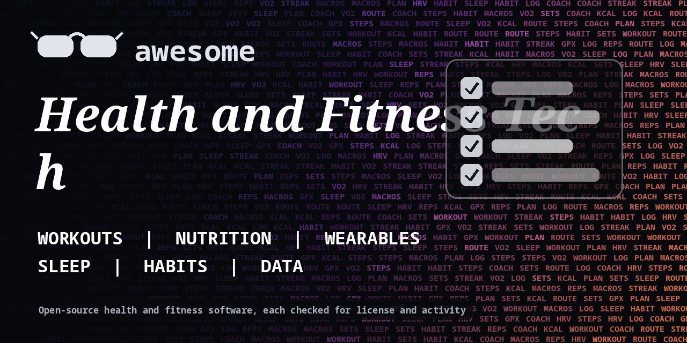

<h1 align="center">Awesome Health and Fitness Tech</h1>

> Open-source workout trackers, nutrition databases, wearable data tools, habit trackers and health data libraries. Every entry shows its license.

**Rules of this list:** every repo exists, is public, is not archived, states a license and has had a commit in the last year. One plain sentence each. Star counts and claims are the authors' own, we did not test every tool. Checked 2026-10-18. See [CONTRIBUTING.md](CONTRIBUTING.md).

## Contents

- [Workout trackers](#workout-trackers)
- [Nutrition and food data](#nutrition-and-food-data)
- [Wearables and activity data](#wearables-and-activity-data)
- [Running, cycling and routes](#running-cycling-and-routes)
- [Habits, sleep and mood](#habits-sleep-and-mood)
- [AI coaches and analysis](#ai-coaches-and-analysis)
- [Health data standards and libraries](#health-data-standards-and-libraries)
- [How to choose](#how-to-choose)
- [Contributing](#contributing)

## Workout trackers

Log sets, reps and plans.

- [wger-project/flutter](https://github.com/wger-project/flutter)  - Mobile app for the wger workout manager. _(AGPL-3.0)_
- [wger-project/wger](https://github.com/wger-project/wger)  - Free, open-source workout and fitness manager. _(AGPL-3.0)_
- [yuhonas/free-exercise-db](https://github.com/yuhonas/free-exercise-db)  - Public domain exercise dataset with instructions and images. _(Unlicense)_

## Nutrition and food data

Track meals and read food databases.

- [mealie-recipes/mealie](https://github.com/mealie-recipes/mealie)  - Self-hosted recipe manager and meal planner. _(AGPL-3.0)_
- [openfoodfacts/openfoodfacts-python](https://github.com/openfoodfacts/openfoodfacts-python)  - Python SDK for the Open Food Facts API. _(check repo)_
- [openfoodfacts/openfoodfacts-server](https://github.com/openfoodfacts/openfoodfacts-server)  - Server behind Open Food Facts, a free food products database. _(AGPL-3.0)_
- [openfoodfacts/smooth-app](https://github.com/openfoodfacts/smooth-app)  - Open Food Facts mobile app for scanning and comparing food. _(Apache-2.0)_
- [TandoorRecipes/recipes](https://github.com/TandoorRecipes/recipes)  - Self-hosted recipe manager with meal planning and shopping lists. _(check repo)_

## Wearables and activity data

Pull data from watches and bands.

- [cyberjunky/python-garminconnect](https://github.com/cyberjunky/python-garminconnect)  - Python wrapper for the Garmin Connect API. _(MIT)_
- [tcgoetz/GarminDB](https://github.com/tcgoetz/GarminDB)  - Download and parse Garmin health and activity data into SQLite. _(GPL-2.0)_
- [the-momentum/open-wearables](https://github.com/the-momentum/open-wearables)  - Open-source platform that unifies wearable data from many providers. _(MIT)_

## Running, cycling and routes

Training logs and GPX tools.

- [endurain-project/endurain](https://github.com/endurain-project/endurain)  - Self-hosted fitness tracking service. _(AGPL-3.0)_
- [GoldenCheetah/GoldenCheetah](https://github.com/GoldenCheetah/GoldenCheetah)  - Cycling power analysis and training software. _(GPL-2.0)_
- [stravalib/stravalib](https://github.com/stravalib/stravalib)  - Python library for the Strava API v3. _(Apache-2.0)_
- [tkrajina/gpxpy](https://github.com/tkrajina/gpxpy)  - GPX file parser and manipulation library for Python. _(Apache-2.0)_
- [yihong0618/running_page](https://github.com/yihong0618/running_page)  - Make your own running home page from many apps. _(MIT)_

## Habits, sleep and mood

Build routines and notice patterns.

- [glanceapp/glance](https://github.com/glanceapp/glance)  - Self-hosted dashboard for feeds and personal info. _(AGPL-3.0)_
- [HabitRPG/habitica](https://github.com/HabitRPG/habitica)  - Habit-building and productivity app that treats life like a game. _(check repo)_
- [iSoron/uhabits](https://github.com/iSoron/uhabits)  - Habit tracker for Android that helps you build good habits. _(GPL-3.0)_

## AI coaches and analysis

Models for form and plans. Not medical advice.

- [google-ai-edge/mediapipe](https://github.com/google-ai-edge/mediapipe)  - Cross-platform framework for on-device ML, including pose tracking. _(Apache-2.0)_
- [ultralytics/ultralytics](https://github.com/ultralytics/ultralytics)  - YOLO models for detection, segmentation and pose estimation. _(AGPL-3.0)_

## Health data standards and libraries

FHIR and health data tooling.

- [hapifhir/hapi-fhir](https://github.com/hapifhir/hapi-fhir)  - Java implementation of the FHIR standard. _(Apache-2.0)_
- [medplum/medplum](https://github.com/medplum/medplum)  - Open-source healthcare developer platform built on FHIR. _(Apache-2.0)_
- [openmrs/openmrs-core](https://github.com/openmrs/openmrs-core)  - Open-source medical record system platform. _(check repo)_
- [smart-on-fhir/client-py](https://github.com/smart-on-fhir/client-py)  - Python client for FHIR servers. _(check repo)_

## How to choose

- **Not medical advice.** Talk to a doctor for health decisions.
- **Health data is private.** Prefer tools that store data locally or self-hosted.
- **Check the license.**
- **Wearable formats change.** Check the last commit.

## Contributing

See [CONTRIBUTING.md](CONTRIBUTING.md). One entry per pull request, plain words, real sources only.

## About

Maintained by [@devanasolver](https://github.com/devanasolver). Listings follow the rules in CONTRIBUTING.

## Sponsor me

If this list is useful, [buy me a coffee](https://buymeacoffee.com/isaac49).
